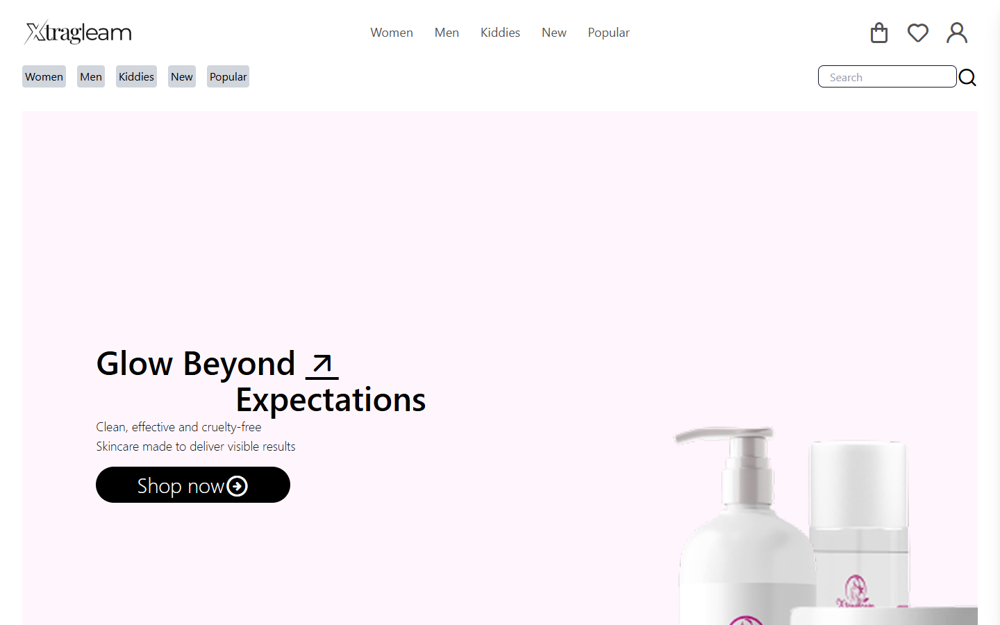
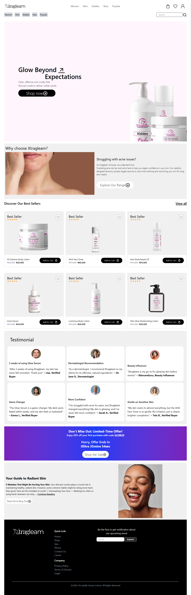
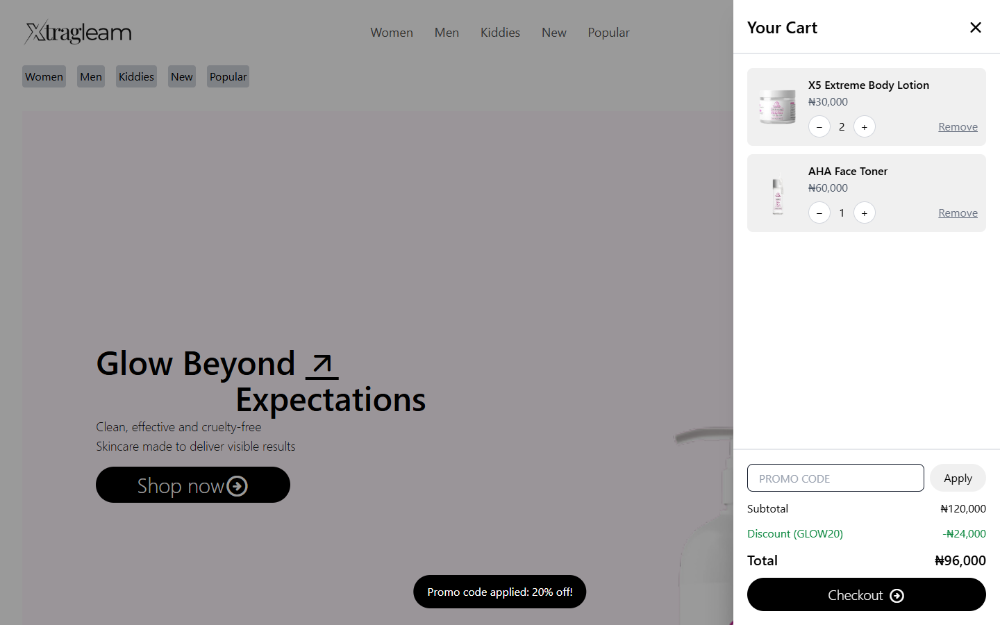
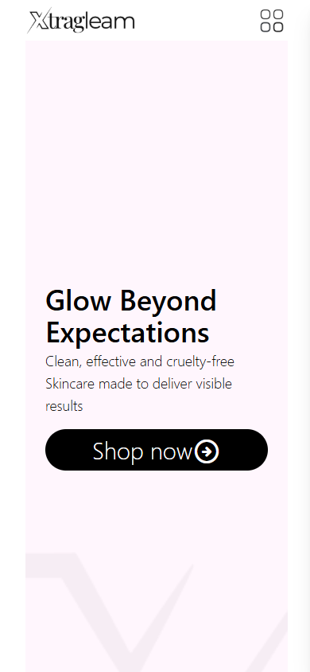
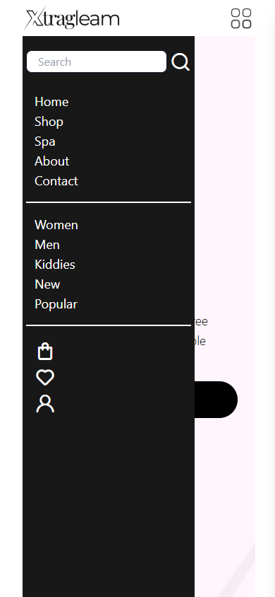
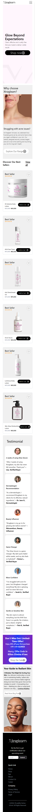

# Xtragleam — Skincare E-Commerce Landing Page

A responsive landing page for **Xtragleam**, a fictional clean-beauty skincare brand. Built with HTML, Tailwind CSS and vanilla JavaScript, it covers a hero section, product showcase, testimonials, a live countdown offer banner, a blog teaser and a newsletter footer — and adapts from mobile to large desktop screens.

**🔗 Live demo:** https://laurence421.github.io/-Skincare-E-Commerce-Landing-Page/



## Features

- **Responsive layout** — mobile-first grid that reflows from 1 column (phone) to 2 (tablet) and 3 (desktop) columns.
- **Mobile slide-in menu** — toggled by the menu icon; closes when you pick a link, tap the page or scroll down.
- **Working cart** — *Add to Cart* updates a badge on the bag icon; the slide-in cart lets you change quantities, remove items, apply the `GLOW20` promo code (20% off) and check out.
- **Wishlist** — tap a heart to save a product; view saved items and move them to the cart.
- **Search & category filters** — search products by name, or filter by Women / Men / Kiddies / New / Popular.
- **Saved between visits** — cart, wishlist and promo are stored in the browser (`localStorage`).
- **Testimonials** — customer, dermatologist and influencer reviews in a card grid.
- **Limited-time offer banner** — live countdown that keeps running across page reloads; click the code to copy it.
- **Skincare guide** — blog teaser that expands to the full "5 mistakes" article.
- **Footer** — newsletter signup with email validation, quick links and company links.

> Front-end only: there is no backend, so checkout and the newsletter are simulated in the browser.

## Screenshots

### Desktop — full page



### Cart with promo code



### Mobile

| Home | Menu open | Full page |
| :---: | :---: | :---: |
|  |  |  |

## Built with

- **HTML5**
- **[Tailwind CSS v4](https://tailwindcss.com/)** — via the browser CDN build (no build step)
- **CSS** — custom styles in `skin.css` (backgrounds, mobile menu animation)
- **Vanilla JavaScript** — menu, cart, wishlist, search, filters, countdown and forms in `skin.js`
- **[Unicons](https://iconscout.com/unicons)** — line icons

## Project structure

```
├── index.html      # Page markup
├── skin.css        # Custom styles
├── skin.js         # Menu, cart, wishlist, search, countdown, forms
├── images/         # Logos, product, profile and section images
└── screenshots/    # README screenshots
```

## Getting started

No install or build needed.

1. Clone the repo:
   ```bash
   git clone https://github.com/Laurence421/-Skincare-E-Commerce-Landing-Page.git
   cd -Skincare-E-Commerce-Landing-Page
   ```
2. Open `index.html` in your browser — or, for best results, serve the folder with a local server such as the VS Code **Live Server** extension.

> An internet connection is required, since Tailwind CSS and the icons load from a CDN.

## Mobile-first & responsive

Built with a **mobile-first** approach using Tailwind CSS responsive modifiers:

- **Mobile-first layout** — designed for phones first using default Tailwind utilities.
- **Responsive breakpoints** — `sm:`, `md:`, `lg:` and `xl:` scale elements, change grid layouts and adjust typography for tablets and desktops.
- **Flexible UI** — a responsive navigation menu and flexible grids that adapt to any screen size.

## Credits & inspiration

- Layout design: [Free Skincare E-Commerce Landing Page (Figma Community)](https://www.figma.com/design/vflcibfBp8oGEV303hxard/Free-Skincare-E-Commerce-Landing-Page--Web-and-Mobile-Responsiveness---Community-?t=FvaTmZ90CU92C6zq-0)
- *This project is front-end cloning practice to improve my HTML, CSS and JavaScript skills.*

## Author

**Laurence** — [@Laurence421](https://github.com/Laurence421)
